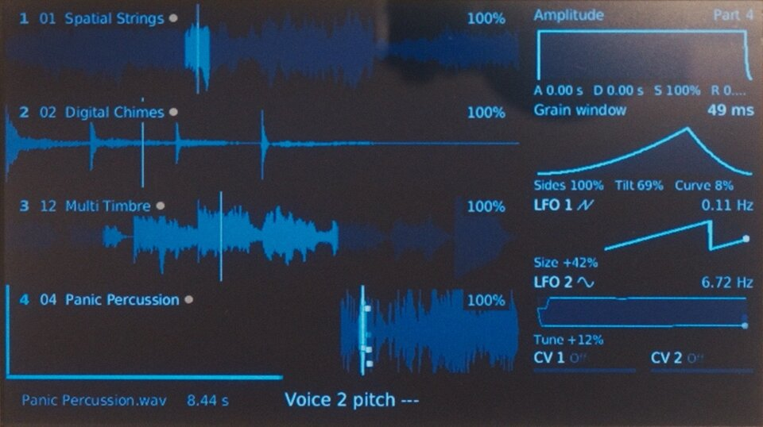
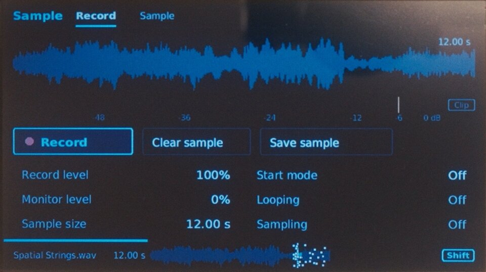
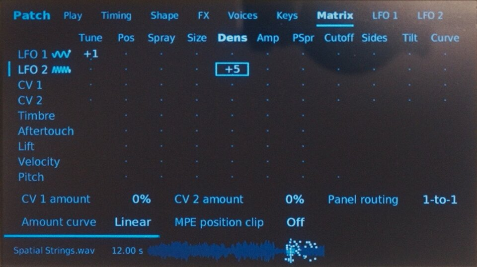
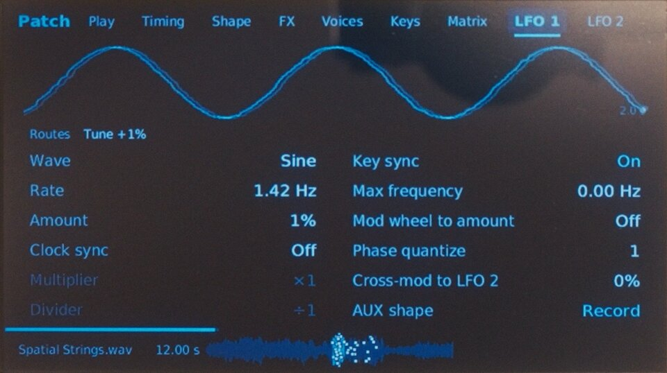
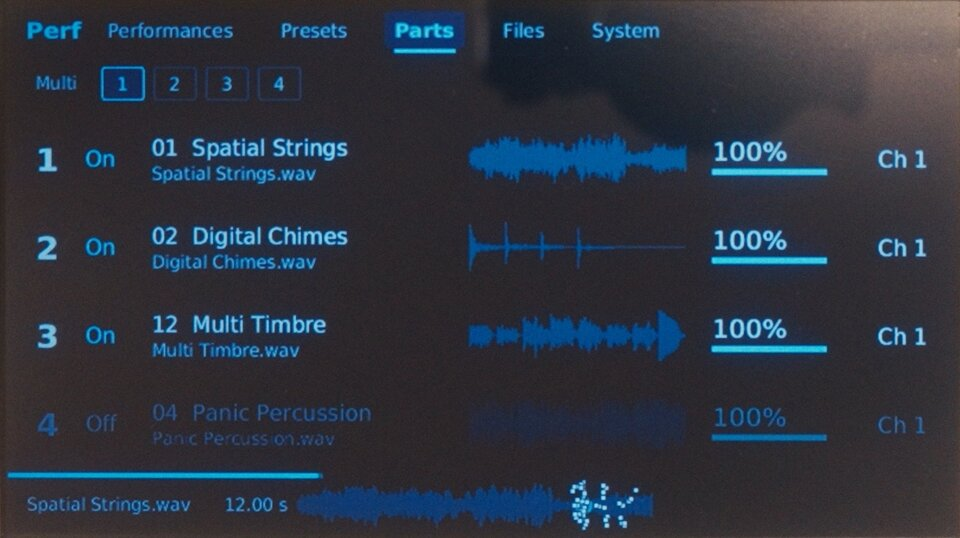
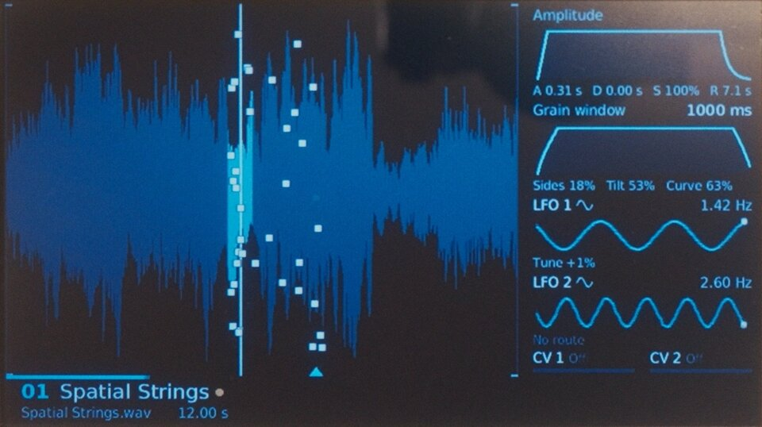

# GR-1 UI

Redesigned UI for the Tasty Chips GR-1

<table>
<tr>
<td width="33%"> Main view</td>
<td width="33%"> Sample recording</td>
<td width="33%"> Modulation matrix</td>
</tr>
<tr>
<td width="33%"> LFO</td>
<td width="33%"> Performance parts</td>
<td width="33%"> Single-part view</td>
</tr>
</table>

## Install

Use the [GR-1 UI website](https://zsoltf.github.io/gr1-ui/) to prepare your USB update.

1. Back up your sounds. Update to [official firmware 3.4.4](https://www.tastychips.nl/gr-1-support/#Firmware)
   if needed, and keep the downloaded file.
2. On the website, choose that file and click **Prepare USB update**.
3. Download the prepared `.tgz` file and copy it to a USB stick, outside any folder.
   Keep only one firmware update at the root of the stick. Do not unpack it.
4. Insert the stick and restart the GR-1. Press **Select** at the update prompt.
5. Let the update finish, remove the stick and restart.

If no update prompt appears, unplug Ethernet and choose
**Shift + Perf → System → Firmware upgrade**. You can reconnect Ethernet afterward.

Keep the GR-1 powered on while it updates. The prepared file contains Tasty Chips
firmware; keep it for your own use.

## Original interface

Download the website's **Original interface startup file** and put it on a USB
stick, outside any folder. Insert the stick and restart the GR-1. Remove the file
or stick to return to the new interface.

## Compatibility

For GR-1 units with a Raspberry Pi 3 Model B Plus and official firmware 3.4.4.
Independent project, not an official Tasty Chips release.

If you installed an earlier version through the network procedure, restore stock
startup before updating. See the [earlier installation guide](docs/owner-install.md).

## Development

- [UI usage](ui/README.md)
- [Build from source](docs/device-build.md)
- [Release notes](RELEASE-NOTES.md)

GitHub Actions builds the UI and website, then deploys to GitHub Pages.
Published files exclude proprietary firmware and the sound engine.

The desktop demo uses synthetic state. Device mode must only run on a supported GR-1.

[MIT license](LICENSE) · [Third-party notices](THIRD-PARTY-NOTICES.md)
